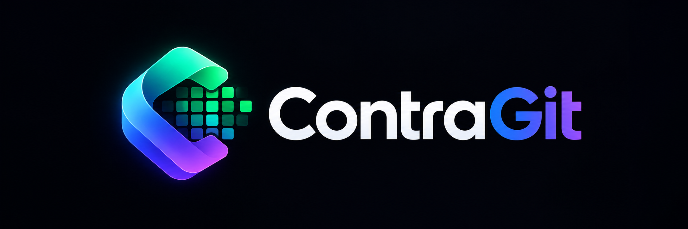
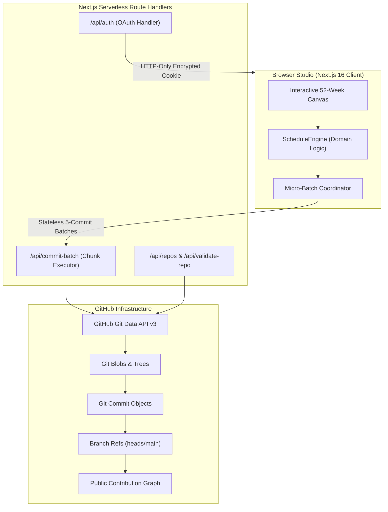

<div align="center">
  <a href="https://github.com/Interittus13/gitcontra">
    
  </a>

  <br/><br/>

  <p><strong>Architect Your GitHub Profile • Precision Contribution Scheduling & Git Activity Studio</strong></p>

  <p>
    <a href="https://github.com/Interittus13/gitcontra/actions/workflows/ci.yml"></a>
    <a href="https://github.com/Interittus13/gitcontra/blob/main/LICENSE"></a>
    <a href="https://nextjs.org"></a>
    <a href="https://react.dev"></a>
    <a href="https://www.typescriptlang.org"></a>
    <a href="https://vitest.dev"></a>
  </p>

  <p>
    <em>Never let enterprise firewalls, private client orgs, or offline flights erase your visible engineering footprint. ContraGit gives developers atomic, fine-grained control to paint text, stencils, and organic streaks directly to GitHub via official low-level Git Data APIs.</em>
  </p>

  <p>
    <a href="#-key-features"><strong>Explore Features</strong></a> •
    <a href="#-architecture"><strong>Architecture</strong></a> •
    <a href="#-quick-start"><strong>Quick Start</strong></a> •
    <a href="#-contributing"><strong>Contributing</strong></a>
  </p>
</div>

---

## 🌟 Why ContraGit?

Your GitHub contribution calendar is often treated as your public engineering resume. In reality, countless software engineers do their most impactful work behind:
- **Private enterprise organizations** with restrictive contribution sharing policies.
- **Air-gapped enterprise networks** where commits cannot sync to personal profiles.
- **Local offline sprints, travel, and flights** that accidentally snap multi-year streaks.

Traditional solutions rely on crude local bash scripts, dangerous Git rebases, and high-risk file manipulations.

**ContraGit** re-engineers this experience from the ground up as a **cloud-native, mobile-first Git studio**. It communicates directly with GitHub's Git Data API to build authentic Git commit graphs, trees, and references in-memory without cloning repositories to disk.

---

## ✨ Key Features

### 🗓️ Precision Schedule Engine
- **Granular Day-by-Day Controls:** Specify target commit volumes for individual weekdays (Monday through Sunday) with intuitive steppers.
- **Intelligent Density Filters:** Apply presets including *All Days*, *Even Days*, *Odd Days*, and *Organic Randomizer* with custom min/max bounds.
- **Natural Gaussian Variation:** Configurable commit randomization prevents rigid, artificial-looking uniform commit tallies.

### 🎨 Pixel Typography & Stencil Library
- **Built-In 5×7 Bitmap Alphabet:** Spell any word, username, or ASCII message across your 52-week calendar with real-time stencil previews.
- **Predefined Stencils:** Instant 1-click presets for **Hearts**, **Retro Space Invaders**, and **Zigzags**.
- **Interactive Stencil Playground:** Test words and preview commit densities and active days live on the landing page simulator.

### ⚡ Resilient Stateless Micro-Batching
- **Sleep & Disconnect Immune:** Authors commits in atomic, 5-commit chunks.
- **Automatic Resume:** If your laptop closes, Wi-Fi drops, or your browser tab closes, commits are already safely stamped on GitHub. Reopening the studio resumes progress immediately.

### 🛡️ 100% Native Git Data API Architecture
- **Zero Local Disk Writes:** No disk space required, no terminal commands, and no local `git clone` overhead.
- **In-Memory Objects:** Creates Git blobs, trees, commit objects, and atomic branch reference pointers directly through GitHub REST endpoints.

### 📱 Mobile-First Studio UI
- **Touch-Optimized Canvas:** Includes dedicated **Pan vs. Draw** touch toggles and a **1.5x Zoom** mode for thumb-level precision on phones and tablets.
- **Dark Aesthetic:** Designed around principles—fluid spring physics, segmented controls, specular rim highlights, and zero layout shift.
- **Docked Safety Controls:** Safe-area responsive navigation and bottom command decks designed for mobile ergonomics.

### 🔒 100% Private — Zero Server-Side Database
- **No Token Storage:** ContraGit stores **zero** personal code, access tokens, or repository content on any external database.
- **Stateless HTTP-Only Sessions:** OAuth tokens exist strictly inside encrypted, secure session cookies on your own client browser.

---

## 🏗️ Architecture



---

## 🚀 Quick Start

### 1. Prerequisites
- [Node.js](https://nodejs.org/) `>= 18.18.0` (Node 20+ recommended)
- `npm` `>= 9.0.0`
- A registered [GitHub OAuth Application](https://github.com/settings/developers)

### 2. Register GitHub OAuth App
1. Go to **[GitHub Developer Settings &rarr; OAuth Apps](https://github.com/settings/developers)**.
2. Click **New OAuth App**.
3. Set the following fields:
   - **Application name:** `ContraGit Development`
   - **Homepage URL:** `http://localhost:3000`
   - **Authorization callback URL:** `http://localhost:3000/api/auth/callback`
4. Generate a **Client Secret** and copy both your `Client ID` and `Client Secret`.

### 3. Clone & Configure Environment
```bash
# Clone the repository
git clone https://github.com/Interittus13/gitcontra.git
cd gitcontra

# Copy sample environment configuration
cp .env.example .env
```

Edit `.env` with your OAuth credentials:
```env
GITHUB_CLIENT_ID=your_oauth_client_id_here
GITHUB_CLIENT_SECRET=your_oauth_client_secret_here

# Optional: Default target repo to pre-populate in the studio
REPO_OWNER=Interittus13
REPO_NAME=gitcontra

# Optional: GitHub user profile for optional follow action
GITHUB_FOLLOW_USER=Interittus13
```

### 4. Install & Launch
```bash
# Install dependencies
npm install

# Start development server with Turbopack
npm run dev
```

Open [http://localhost:3000](http://localhost:3000) in your browser (works across Chrome, Brave, Safari, and Firefox).

---

## 🧪 Testing & Verification

ContraGit maintains 100% green verification pipelines across TypeScript, unit testing, and production builds.

```bash
# Run TypeScript compilation check
npm run typecheck

# Run unit tests via Vitest
npm test

# Build production bundle with Next.js Turbopack
npm run build

# Run comprehensive CI pre-flight suite
npm run check
```

---

## 🧩 Browser Extension Setup (Chrome / Brave / Edge)

ContraGit ships with an unpackable **Manifest V3** browser extension for quick access:

1. Open your browser extension settings:
   - **Chrome / Brave:** `chrome://extensions/`
   - **Edge:** `edge://extensions/`
2. Enable **Developer mode** toggle in the top-right corner.
3. Click **Load unpacked** and select the [`extension/`](./extension) folder.
4. Launch the extension popup from your browser toolbar!

---

## 🛡️ Security & Privacy

- **Stateless OAuth:** Access tokens are stored exclusively inside encrypted, HTTP-only, SameSite cookies.
- **Minimal Scopes:** Requests only the minimum required GitHub scopes (`read:user`, `user:email`, `repo`).
- **Zero Third-Party Trackers:** No analytics trackers, no telemetry probes, and no marketing beacons.
- For vulnerability reporting, please review our [Security Policy](SECURITY.md).

---

## 🤝 Contributing

We welcome contributions of all levels! Please check out our [Contributing Guidelines](CONTRIBUTING.md) and [Code of Conduct](CODE_OF_CONDUCT.md) before submitting a Pull Request.

1. Fork the repo and create your branch: `git checkout -b feat/your-feature-name`
2. Ensure all tests pass: `npm run check`
3. Commit with Conventional Commits: `git commit -m 'feat: describe your change'`
4. Submit your PR using the [Pull Request Template](.github/PULL_REQUEST_TEMPLATE.md).

---

## 📄 License

This project is open-source software licensed under the **[MIT License](LICENSE)**.

<div align="center">
  <sub>Crafted with precision for developers who take pride in their craft.</sub>
</div>
